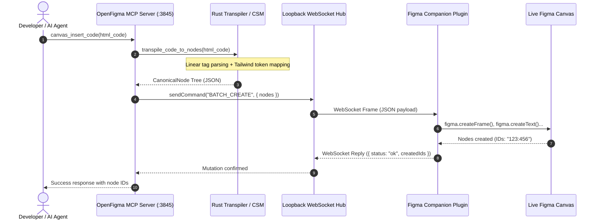

# 🔄 DESIGN-TO-CODE AST & BIDIRECTIONAL CANVAS MUTATION PARADIGMS
## Analysis of Builder.io `html-to-figma`, `bernaferrari/FigmaToCode`, Grida IR, and Loopback WebSocket Mutations

> **Protocol Execution:** *Shivam SEED Protocol — Maximum Cognitive Depth, Ground-Truth Evidence, Algorithmic Rigor, and Zero-Compromise Engineering.*

---

### Executive Summary

The interface between visual design (Figma) and code (HTML, JSX, Tailwind) has historically been a **one-way lossy projection**: designers draw shapes, developers reconstruct them manually in CSS.

Modern AI coding agents require a **bidirectional closed feedback loop**:
1. **Design $\to$ Code:** The AI reads the design and synthesizes code.
2. **Code $\to$ Design:** The AI edits or generates code, and the changes are instantly reflected on the Figma canvas for visual review.

In this deep investigation, we dissect the state of the art in bidirectional design engineering:
* **Builder.io `figma-html`** ([`github.com/BuilderIO/figma-html`](https://github.com/BuilderIO/figma-html)): Converts live DOM / HTML into Figma layers.
* **Bernardo Ferrari's `FigmaToCode`** ([`github.com/bernaferrari/FigmaToCode`](https://github.com/bernaferrari/FigmaToCode)): High-fidelity Figma to Tailwind/Flutter/SwiftUI translator.
* **Grida Intermediate Representation (IR)**: Universal abstract scenegraph tree.
* **OpenFigma's Bidirectional Canvas Mutation Bridge**: Native loopback WebSocket channel with sub-10ms write latency.

---

### 1. Reverse-Engineering Builder.io `html-to-figma`

From `research_ecosystem/repos/builderio-figma-html/`:

#### The DOM Ingestion Algorithm:
1. **Computed Style Inspection:**
   - Traverses live browser DOM nodes using `window.getComputedStyle(element)`.
   - Extracts geometry: `element.getBoundingClientRect()` (`x`, `y`, `width`, `height`).
2. **Layer Mapping Rules:**
   - If element has child text nodes $\to$ Emit `TEXT` node with computed font family, size, line-height, weight, and letter-spacing.
   - If element has `background-color`, `border-radius`, or `box-shadow` $\to$ Emit `RECTANGLE` or `FRAME` node.
   - If element is an `<svg>` or `` $\to$ Rasterize or convert to vector paths.
3. **Hierarchy Preservation:**
   - Recursively maps parent-child container relationships, converting `display: flex` into Figma Auto Layout properties (`layoutMode`, `itemSpacing`, `paddingLeft`, etc.).

#### Key Architectural Limitation of `html-to-figma`:
* Requires a running browser DOM environment (`document`, `window.getComputedStyle`).
* Cannot run in headless CLI or server-side Rust environments without launching a heavy headless Chrome / Puppeteer instance.

---

### 2. Reverse-Engineering `bernaferrari/FigmaToCode`

From `research_ecosystem/repos/bernaferrari-FigmaToCode/`:

#### The Codegen Pipeline:
1. **Node Visitor:** Walks the Figma scenegraph recursively (`FRAME`, `TEXT`, `RECTANGLE`, `VECTOR`, `COMPONENT`).
2. **Property Extraction:**
   - Reads fills and converts normalized RGB (`0.0 - 1.0`) to hex `#RRGGBB` or Tailwind color names.
   - Reads Auto Layout and maps to Tailwind flexbox classes (`flex flex-row items-center justify-between p-4 gap-2`).
3. **Multi-Target Generators:**
   - **Tailwind Generator:** Synthesizes `className="..."` strings.
   - **Flutter Generator:** Synthesizes Dart widget trees (`Container`, `Row`, `Column`, `Text`, `BoxDecoration`).
   - **SwiftUI Generator:** Synthesizes Swift structures (`HStack`, `VStack`, `Text`, `.padding()`, `.background()`).

#### Key Architectural Limitation of `FigmaToCode`:
* Relies on heuristic template strings rather than compiler-grade Abstract Syntax Trees (ASTs).
* Emits hard-coded pixel widths when Auto Layout is missing, creating brittle, non-responsive components.

---

### 3. OpenFigma's Bidirectional Architecture: Transpiler + Companion Bridge

OpenFigma Beast Edition solves the dual problems of server-side speed and live canvas mutation through a two-tiered system:

#### The Transpilation Engine (`src/canvas/transpiler.rs` & `src/tools/transpiler.js`):
* **Linear-Time Tag Scanner:** Operates without a heavy headless browser or JSDOM dependency.
* **Tailwind Utility Lexer:**
  - `bg-blue-600` $\implies$ `Fill(Solid, #2563EB)`
  - `text-white` $\implies$ `FontColor(#FFFFFF)`
  - `p-6` $\implies$ `Padding(24px)`
  - `rounded-xl` $\implies$ `CornerRadius(12px)`
  - `flex flex-col` $\implies$ `AutoLayout(Vertical)`
* **Atomic Batch Instantiation:** Transpiles entire component trees into a single atomic payload dispatched over WebSocket, preventing canvas flickering and maximizing rendering performance.
